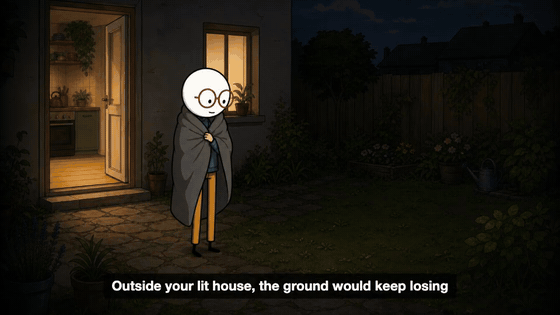
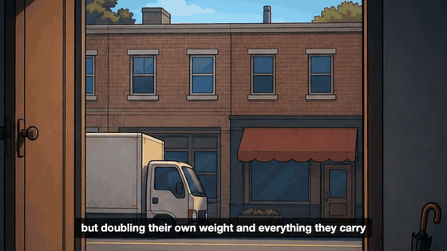

# Lumen

**Ask a question. Get a narrated, animated film.**

Lumen turns one sentence into a three-minute explainer film: it plans the story, draws every shot, records the
voice, directs the camera, and starts playing while the rest of the film is still being made.

There is no video model and no render farm. A language model writes a plan and a small JSON scene format; an
image model draws the frames; the browser draws the film live on an HTML5 canvas, where every frame is a pure
function of time.

## Two films it made

Both films below were made from the one-line question shown, with no editing. Click a preview to watch the
full film with sound.

| "What if the Sun went out for one day?" | "What if gravity doubled overnight? Could you survive 24 hours?" |
| --- | --- |
| [](docs/films/sun-went-out.mp4) | [](docs/films/double-gravity.mp4) |
| [Watch the full film (3 min 15 s, MP4)](docs/films/sun-went-out.mp4) | [Watch the full film (3 min 36 s, MP4)](docs/films/double-gravity.mp4) |
| 14 pictures, 7 scenes, two to four shots a scene. Planned with the `explain` narrative and three visual skills. | 7 pictures, 8 scenes. An earlier version of the planner: one shot a scene. |

What to look for:

- **One world, one character.** Every picture is a full scene with its setting, and the same character appears
  throughout.
- **Change in place.** The kitchen is shown sunlit, dark, and sunlit again in exactly the same framing.
- **The camera follows the sentence.** It pushes in on the thing being talked about and returns to the whole
  picture when the voice moves on.
- **Words land on the voice.** Subtitles, labels, numbers and a character's own line ("I feel COLDER.") appear
  on the word that says them.

## How it works

```
question
   │
   ▼
1. PLAN      one streamed model call → title, character, pictures, steps
   │         (read while it is still arriving)
   ├──────────────► 2. PICTURES   each starts drawing the moment its entry closes, 4 at a time
   │                              then a vision model finds each named part's box
   ├──────────────► 3. VOICE      each step is spoken, then timed word by word
   ▼
4. SCENES    one writer per step, 4 at a time, earlier steps first
   │         JSON checked; one repair, one corrective retry
   ▼
5. STREAM    scenes are released strictly in order
   │
   ▼
6. PLAYER    plays scene 1 as soon as it is ready; waits if the next one is not
```

1. **Plan.** The planner first loads its teaching: one narrative skill (how this kind of film tells its
   answer) and up to four visual skills (how each shape of idea is shown). It then writes the narration step
   by step, a brief for every picture, and what the screen does on each clause.
2. **Pictures.** The plan's key order is fixed so pictures come before steps. Drawing, the slowest stage,
   starts while the planner is still writing. The first picture sets the style and character for the rest; a
   later moment of the same shot is redrawn from the earlier one, so the framing holds.
3. **Voice.** Each step is spoken as soon as it is planned, and the clip is measured for the time of every word.
4. **Scenes.** A scene writer turns one step into beats. It never writes a coordinate, a time or an image
   address: it names pictures and their parts by id, and ties each beat to the narration words it lands on.
5. **Stream.** Scenes are sent as events in step order, however they finish. A scene that cannot be made is
   dropped and the film carries on.
6. **Player.** Each scene is compiled into a timeline and appended. The clock is the voice itself, so picture
   and sound cannot drift.

### What a scene looks like

This is what a scene writer produces for one step. The server adds each picture's address and part boxes.

```json
{
  "objects": [
    { "id": "roof-dark", "kind": "image" },
    { "id": "battery-lamp", "kind": "image", "initial": "hidden" }
  ],
  "beats": [
    { "id": "open", "actions": [{ "do": "camera", "target": "roof-dark", "shot": "overview" }] },
    { "id": "panels", "say": "Your rooftop solar panels", "pace": "slow",
      "actions": [{ "do": "camera", "target": "roof-dark.panels", "shot": "close", "movement": "push" }] },
    { "id": "lamp", "say": "a charged home battery", "pace": "slow",
      "actions": [{ "do": "cut", "to": "battery-lamp" }] }
  ]
}
```

Actions: `camera`, `cut` (hard, iris or dissolve), `label`, `speak` (a speech bubble), `attention` (dim,
encircle, pulse), `show` and `hide` for words, formulas, counters and charts, `shake`, `flash`.

## Run it

```bash
npm install
npm run dev
```

Open the address it prints. Saved films play straight away. To make new ones, create `.env` in this folder:

```
OPENAI_API_KEY=sk-...
```

| Setting | What it does |
| --- | --- |
| `OPENAI_API_KEY` | Required to make films: planning, scene writing, drawing, part finding and voice. |
| `FILM_SKILLS_DIR` | Optional. A folder with `narrative/` and `visual/` Markdown skills for the planner to load. |
| `CARTESIA_API_KEY` | Optional. Speak with Cartesia instead of the OpenAI voice. |
| `FILM_PLAN_MODEL`, `FILM_WRITE_MODEL`, `FILM_IMAGE_MODEL`, `FILM_INSPECT_MODEL`, `FILM_TTS_MODEL`, `FILM_TTS_VOICE` | Optional model overrides. |
| `FILM_PROVIDER=offline` | A canned film with drawn stand-in pictures, for working on the pipeline without spending. |

A film takes two to four minutes to make and costs real money in model and image calls.

### Export a film to video

The films above were exported with this. A film is a pure function of time, so a video is that function
sampled 24 times a second in a headless browser, joined with the voice.

```bash
npm run dev                                                   # in one terminal
npm run export -- <run> --out docs/films/my-film.mp4 --gif 80:12
```

`<run>` is a folder name under `runs/`. `--gif start:seconds` also writes a silent preview. Needs `ffmpeg` and
a Chrome or Chromium (set `CHROME_PATH` if it is not found).

### Check it

```bash
npm test         # 52 tests: plan streaming, pipeline order and recovery, timing, validation, playback
npm run build    # type check and production build
```

## What is in here

```
server/      the film pipeline, mounted on the Vite dev server
  film.ts      plan → pictures → voice → scenes → in-order release
  prompts.ts   the planner, part finder, scene writer and the picture look
  skills.ts    loads planner skills and answers the load_film_skills tool
  providers/   OpenAI, Cartesia voice, and an offline stand-in
src/film/    the film engine, in the browser
  validate.ts  the verdict on one scene (shared with the server)
  resolve.ts   scene + voice timing → a timeline in seconds
  render.ts    draws one scene at time t
  compiler.ts  scenes added one by one; a film that grows while it plays
  store.ts     receives the stream, admits scenes in order
  playback.ts  the cursor: play, wait, finish
src/components/FilmStudio.tsx   the app
src/render/  canvas primitives: charts, math, motion, lettering
scripts/export-film.mjs         film → MP4
docs/films/  the two films above
```

More detail for contributors and coding agents is in [`AGENTS.md`](AGENTS.md).

## Limits

- Pictures are still frames. Nothing inside a frame moves on its own; motion comes from the camera, cuts and
  later moments of the same shot.
- The image model sometimes adds or misplaces things. One shot in the Sun film has the character standing in
  space; the drawing prompt has since been tightened.
- Planning with skills loaded takes about two minutes, so the first scene arrives after roughly three.
- The film server runs inside the Vite dev server. There is no production deployment yet.

## Credits

The pipeline's shape (a streamed plan, pictures drawn in parallel, scenes released in order) and the planner's
teaching follow the film feature built at AiRA.
